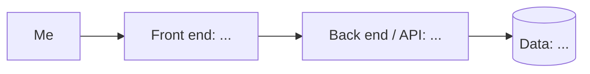

<!--
  Product 1 Spec Template
  Paste this into any document you can save (Google Docs, Word, Notes, a text
  editor). On Wednesday it becomes the README.md of your Product 1 repository.
  Walkthrough, examples, and AI prompts are in the guide:
  https://github.com/464squad/IEL/blob/main/projects/product-1/product-spec-guide.md
  Delete these instructions and the italic hints as you fill each section in.
-->

# [liftset]

> One line: what this is and who it's for (hint: it's for you).
It’s an app that keeps track of your weights per set meant to help me remember last sets.

**Author:** [Daiana Ortiz] · **Course:** CMP 464/343 Product 1 · **Last updated:** [9/28/2026]

---

## 1. About Me (the User)

*Who am I in the context of this problem? What roles am I playing (student, employee, parent, athlete, gamer…)?*

[I am a person who works out and has gym/physical goals]

**The last 3 times this happened:**
-A first time this happened was after taking a short break from the gym
-A second time was when I started going with my friend to the gym and we were doing different weights
-A third time is when I got overwhelmed with finals, so I decided to focus fully on school and not the gym.
*Real, recent moments. For each: when and where, what went wrong, what it cost, what you did.

1. I usually plan my workouts before I go to the gym, so if I can’t remember what weight I last did then I'm just guessing what weight to do.
2. Usually when I am working out with my friends I also forget which set I was on so I might redo/ relift the same weight which is not great for progressive overload
3. Due to me not knowing the weight and guessing what I hit last time, I tend to go easier on myself or harder which is not great in preventing injury from happening.

**What it costs me:**
*Be specific. How often, how much?*

- ⏱️ Time: 1 HR plotting my time before the gym and what weight to do during the gym
- 💸 Money: $2 for an energy drink
- 🔋 Energy: Not enough exertion/ too much exertion
- 🙂 Joy: Not meeting my goals as quickly as I could

---

## 2. Problem Statement

**Gut check:**

> I need **[to keep a history of my weights and reps at the gym]** because **[it will help me to reach my gym goal of building the physique that I want and improve my health]**.

**Five Whys:**
1. Why? To gain muscle
2. Why? To avoid injury 
3. Why? To become healthier
4. Why? To spend less time calculating
5. Why? To use my energy to its full capacity

**Problem statement:**

> **When** [I go to the gym I feel like I keep doing the same weight].,
> **I struggle to** [remember the last weight I did prior],
> **which costs me** [time:about a 30 minutes to an hour plotting the weight: to do before the gym, during my workout, readjusting my weights/ cost: me roughly $2-$3 of the energy drink I buy that’s going to waste / energy: the mental load needed to remember weeks prior of everything / joy: makes me feel like I didn’t get a good workout in].
> **This happens because** [I rely on my memory or notes on my phone that I don’t organize and rarely check back on].
> **Right now I** [attempt to keep it all in one file in notes], **but** [it falls short because the file is disorganized and there's just a bunch of random numbers].

**I'll know this is solved when:** [I can see prior weights lifted in compared to the new ones done, reaching progressive overload]

*Check: none of these words appear: app, website, platform, dashboard, tool, AI, track, automate, notify, feature.*

---

## 3. Existing Solutions

| What I use or tried | What it does well | Why it falls short *for me* |
| Notes | allows to store anything | disorganized |
| Habit Tracker | You can set what you want to focus on| Not really mean to track workouts | 
| Apple fitness | tracks exertion | Doesn’t track weights and reps |
| | | |

**The gap:** *In one sentence, what's still missing for me?*

[Weights, reps, and sets history viewing]

---

## 4. Features & Benefits

*Every feature should move me toward my "solved when" line.*

| Feature (what it does) | Benefit (how my life gets better) | MVP or Later? |
| Workout Routine | Have an easy to view workout routine | MVP |
| Table: for weights, sets, and reps | easy to update/ modify | MVP |
| History view of specific workout info with dates | viewing progressive overload| Later |
| New weights prediction | can choose if i want to focus on strength building or endurance| Later|
| Compare weights with hormonal time | see progression during hormonal changes | Later |

**MVP (2–3 features):** *The skateboard: the smallest version I'd actually use.*
- Table for weights, reps, sets
- workout routine

**Later:**
- new weight prediction
- history view of workout info with dates

**Not doing:** *Things I'm deliberately leaving out.*
- For now: weights done in association with hormonal changes

---

## 5. Tech Stack

### Front end
- **Surface:** [CLI / Web / Mobile / Cross-platform / Chat]
- **Tools:** [e.g., Next.js, Python, Expo]
- **Why:** *How does this fit where and when I have the problem?*

### Back end
| Piece | Choice | Why |
|---|---|---|
| Server / API | | |
| Data storage | | |
| Outside services (optional) | | |
| Hosting / deploy | | |

### Architecture sketch

---

## 6. Open Questions

*What am I still unsure about? What do I need to figure out or test first?*

- 
